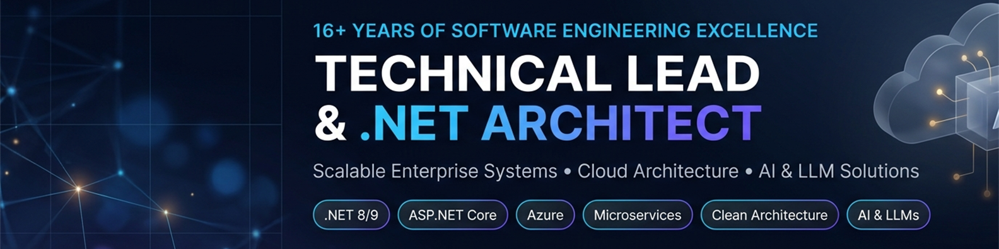

# Hi there 👋, I'm Ahmed Samy

  

### 🚀 About Me
- 💼 **Technical Lead & .NET Software Architect** with 16+ years of enterprise experience.
- 🏗️ Specializing in **C#, ASP.NET Core (.NET 8/9), Azure, Microservices, Clean Architecture, and AI/LLM Solutions**.
- 💡 Passionate about building scalable cloud-native applications, clean code practices, and mentoring engineering teams.

---

### 🛠️ Tech Stack & Skills
- **Languages:** C#, TypeScript, JavaScript, SQL
- **Frameworks & Architecture:** ASP.NET Core, Entity Framework Core, Microservices, Clean Architecture, DDD, CQRS
- **Cloud & DevOps:** Microsoft Azure, Docker, Kubernetes, CI/CD, GitHub Actions
- **Databases:** PostgreSQL, SQL Server, Redis, MongoDB
- **AI & Emerging Tech:** LLM Integration, Semantic Kernel, Prompt Engineering

---

### 🔗 Connect with Me

---
